# Diagram A — MoodOS Complete System Architecture

**One-sentence blueprint:** MoodOS is an MCP-based AI orchestration system that combines persistent user memory (Mem0), adaptive RAG, live external APIs, semantic retrieval, context-aware ranking, and experience planning to transform a user's emotional and situational state into a personalized real-world experience.

**Principle:** The LLM is an orchestrator/reasoner. It is not the database and not the source of truth.

```
LLM ≠ Database     RAG ≠ Training     Mem0 ≠ RAG     Live API ≠ Vector DB
MCP ≠ API Provider     Recommendation ≠ Action     Memory ≠ Ground Truth
```

---

## A0. Condensed end-to-end flow

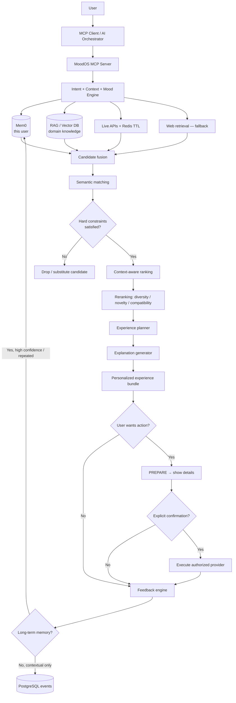

---

## A1. Horizontal layers (system layout)

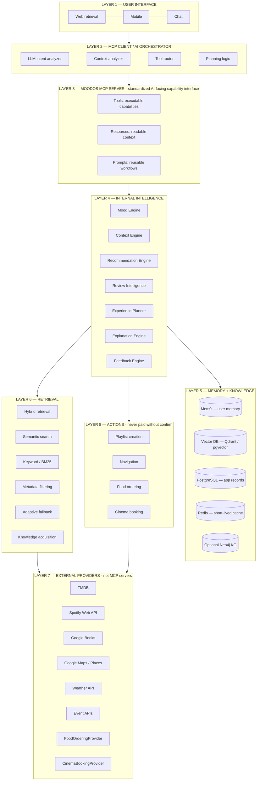

---

## A2. MCP architecture (correct model)

MCP is the **standardized AI-facing capability interface**. External APIs remain **providers** behind the MoodOS MCP server. They are not themselves MCP servers.

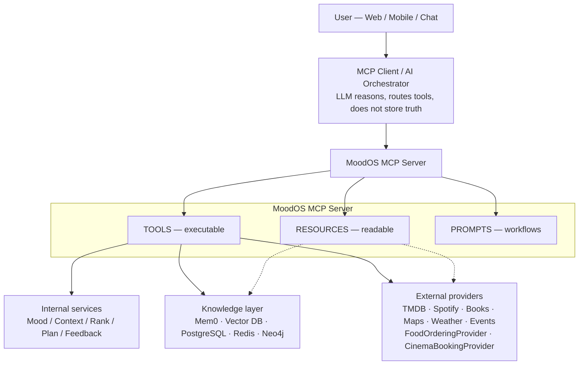

### MCP Tools (executable)

| Tool | Role |
|---|---|
| `analyze_mood` | Current mood, desired mood, intensity, trajectory |
| `extract_preferences` | Explicit + implicit preference slots |
| `get_user_profile` | Authorized profile + preference snapshot |
| `search_movies` | TMDB-backed search (via provider adapter) |
| `search_books` | Google Books adapter |
| `search_music` | Spotify adapter |
| `search_restaurants` | Places / food provider adapter |
| `search_events` | Event provider adapter |
| `get_weather` | Weather provider + Redis TTL |
| `find_nearby_places` | Maps / Places |
| `retrieve_knowledge` | RAG / hybrid retrieval |
| `search_web_knowledge` | Adaptive web fallback |
| `rank_experiences` | Scoring + rerank |
| `build_experience` | Experience planner |
| `analyze_reviews` | Review intelligence |
| `create_playlist` | Authorized Spotify action |
| `prepare_movie_booking` | Draft booking — no charge |
| `confirm_movie_booking` | Execute only after explicit user confirmation |

### MCP Resources (readable context)

- `user://profile`
- `user://preferences`
- `movie://tmdb/{id}`
- `book://google/{id}`
- `experience://cozy-evening`
- `knowledge://mood/relaxation`

### MCP Prompts (reusable workflows)

- `/mood-night` · `/date-night` · `/study-session` · `/rainy-day` · `/weekend-plan` · `/stress-relief`

**Annotation:** MCP exists so the orchestrator calls a stable tool/resource/prompt contract instead of hard-wiring every vendor SDK into the prompt.

---

## A3. Three knowledge sources (must stay separate)

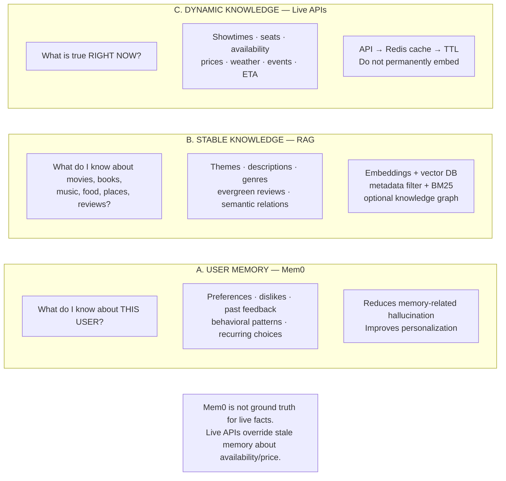

### Mem0 examples (user-specific)

- Prefers psychological thrillers
- Usually avoids horror
- Likes quiet cafes
- Prefers budget-friendly experiences
- Often watches movies alone
- Disliked loud crowded places
- Previously enjoyed a particular experience type

**Do not claim:** Mem0 eliminates hallucinations.  
**Do claim:** Mem0 reduces memory-related errors by retrieving persistent user-specific facts.

---

## A4. Freshness model

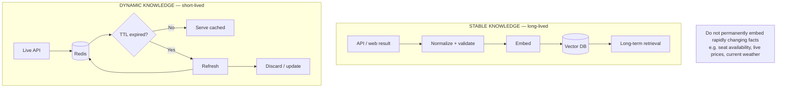

**Annotation:** Redis exists so live facts stay fresh without polluting the vector index.

---

## A5. Adaptive retrieval / fallback (RAG miss is not failure)

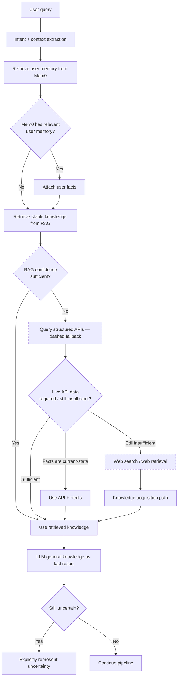

### Automatic knowledge acquisition (usage grows the index)

Retrieved data is **automatically ingested, normalized, validated, deduplicated, embedded, indexed, and made retrievable.** This is not “API data trains the RAG.” RAG is retrieval infrastructure, not model training.

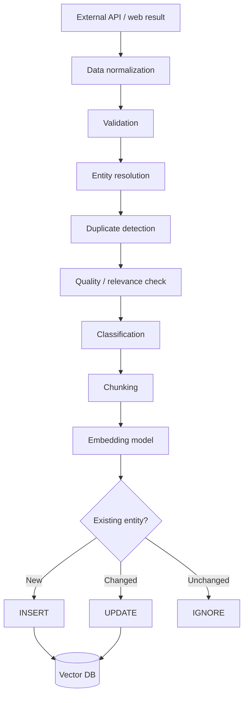

**Annotation:** A RAG miss triggers adaptive knowledge acquisition so the next similar query can retrieve instead of falling back.

---

## A6. Main internal pipeline + Mood / Context engines

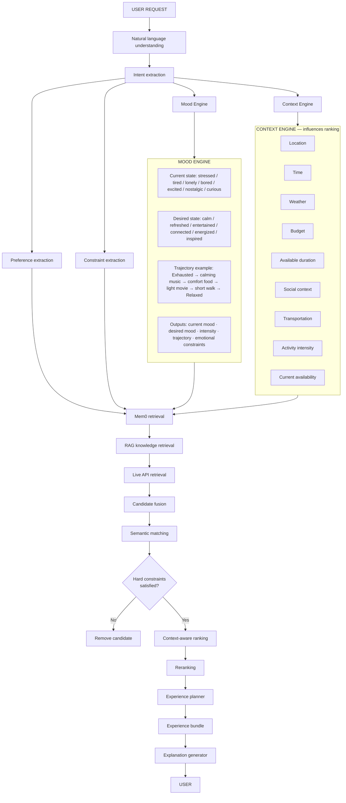

---

## A7. Recommendation engine (multi-stage)

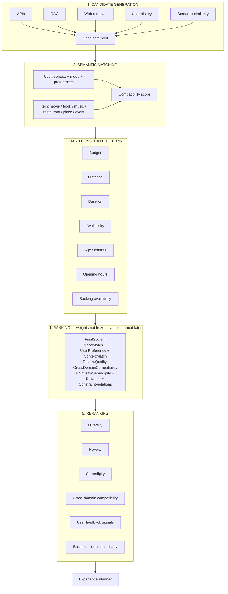

**Annotation:** Reranking exists so the top list is a coherent *set*, not five near-duplicate items.

---

## A8. Review intelligence → ranking features

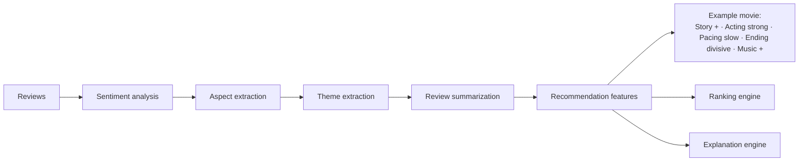

Example explanation: *Recommended because you usually prefer character-driven movies, and reviews indicate strong acting and emotional depth.*

---

## A9. Experience planner (key differentiator)

Does **not** dump isolated items (movie, book, song, restaurant). Builds a **coherent sequence**.

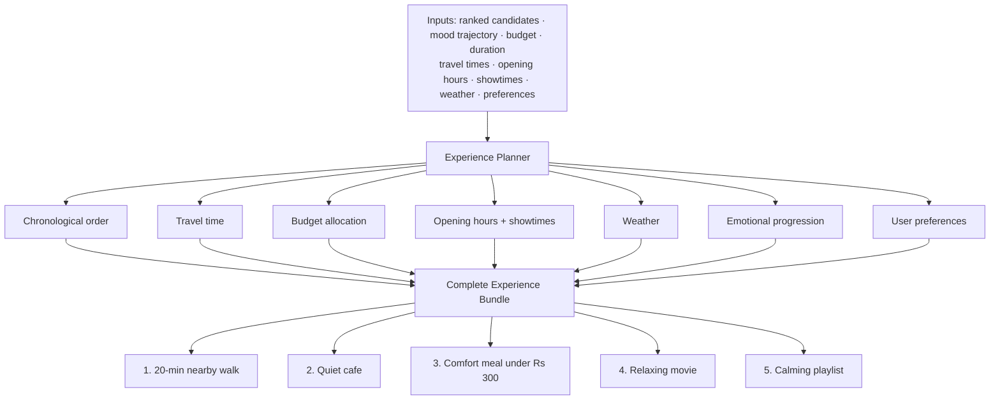

**Annotation:** Experience planning exists because MoodOS recommends a *day/evening*, not a *catalog item*.

---

## A10. Action layer (recommendation ≠ execution)

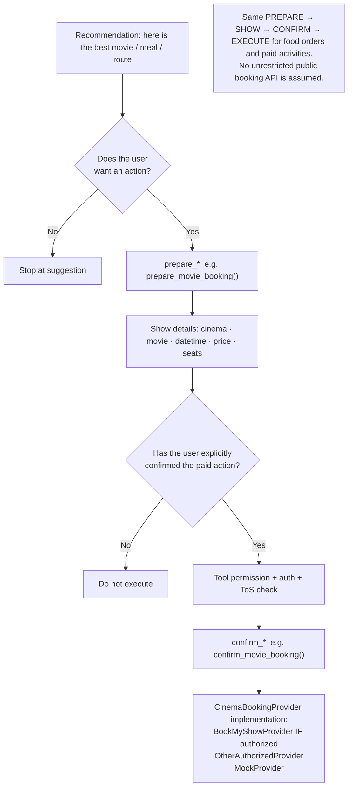

**Annotation:** Booking requires confirmation because paid side-effects must never be implicit LLM tool fire.

---

## A11. Feedback loop (temporary vs long-term)

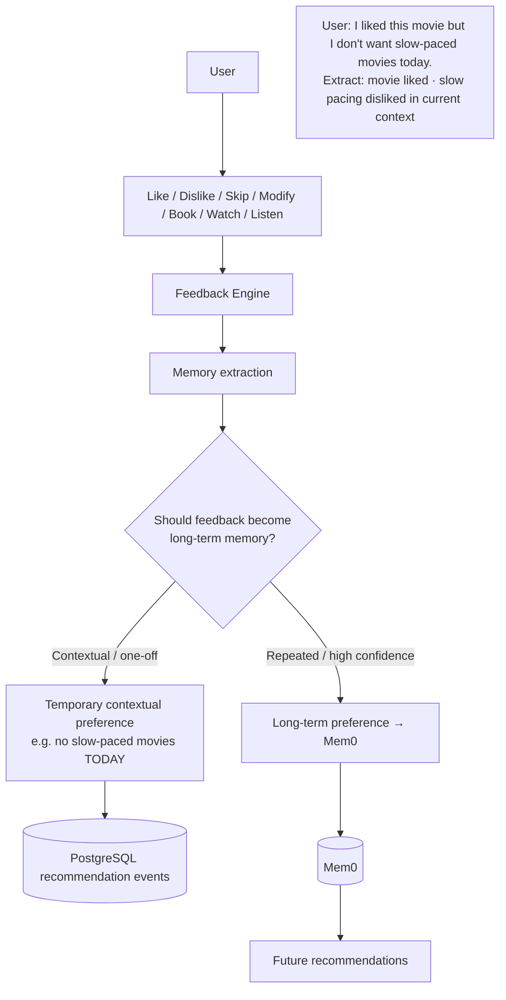

**Annotation:** Feedback goes to Mem0 only when it is a durable user fact, so one rainy-day exception does not rewrite the profile.

---

## A12. Data storage architecture

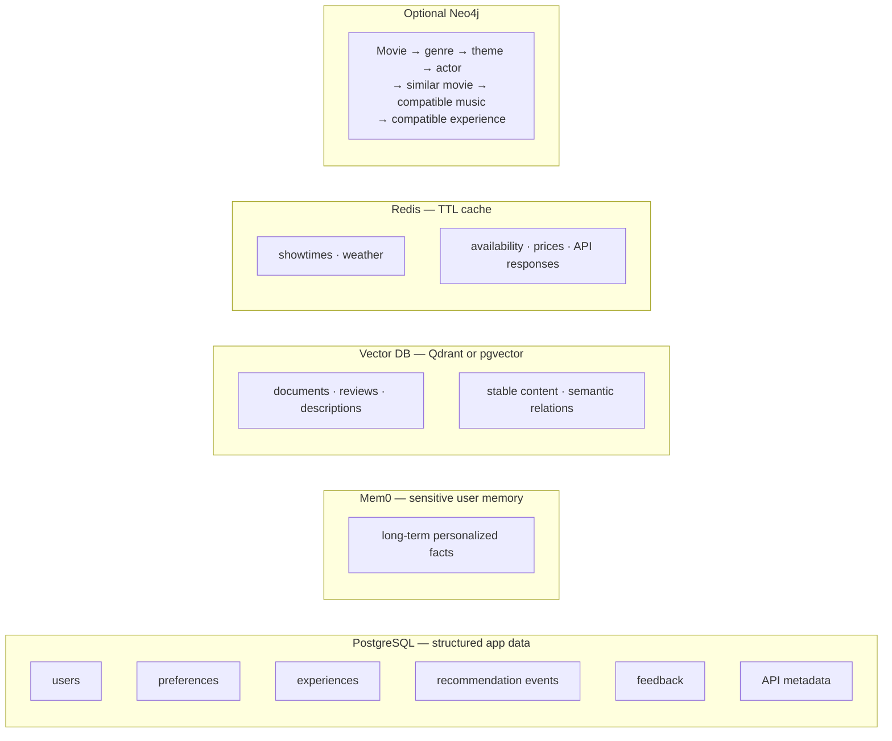

---

## A13. Security / trust boundaries

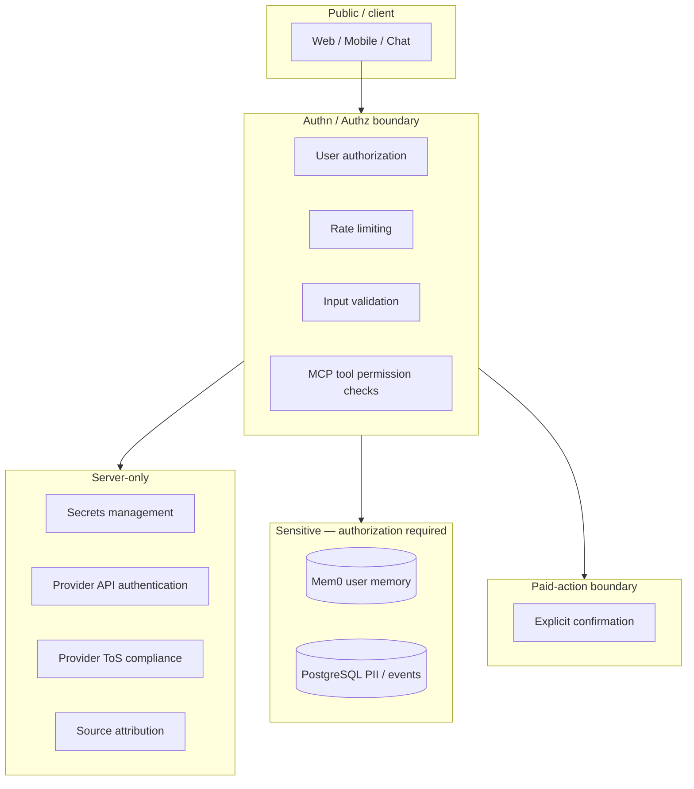

---

## A14. Hallucination / reliability model (not zero hallucination)

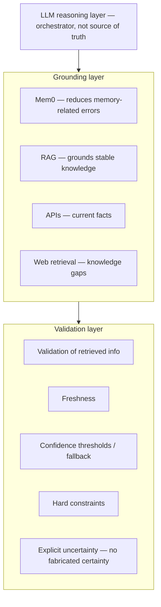

| Mechanism | What it actually does |
|---|---|
| Mem0 | Reduces memory-related errors; does not guarantee truth |
| RAG | Grounds stable domain knowledge at inference time |
| APIs | Authoritative current-state facts |
| Web retrieval | Fills RAG/API gaps |
| Validation | Checks retrieved information before planning |
| Confidence | Controls fallback, does not hide misses |
| Uncertainty | Prevents fabricated certainty |

---

## A15. Internal services vs knowledge vs providers

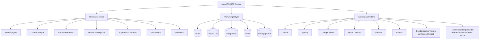
