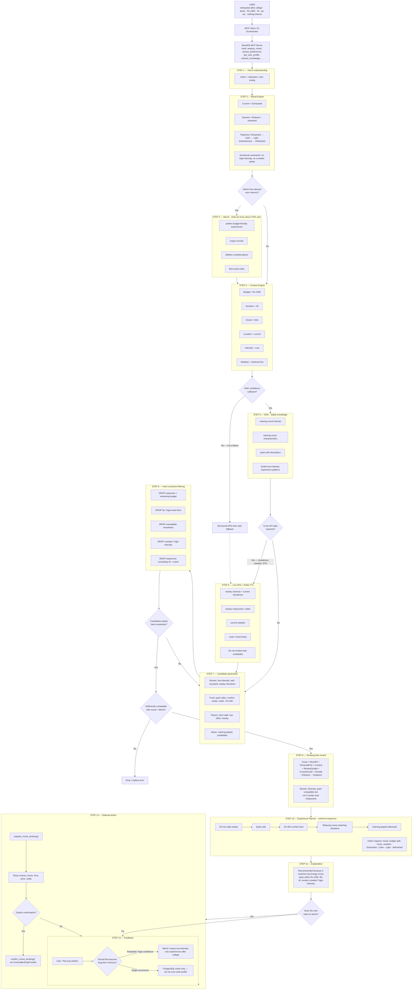
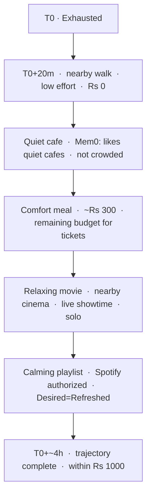

# Diagram B — Worked example (end-to-end)

**User request**

> "I'm exhausted after college, alone, have ₹1000, four hours, and want to go out but nothing intense."

This diagram traces **actual intermediate values** through MoodOS. The LLM orchestrates tool calls; Mem0 / RAG / APIs remain the sources of facts.

---

## B0. Value snapshot (carried through the pipeline)

| Slot | Value | Source |
|---|---|---|
| Intent | Relaxation / solo outing | NLU |
| Current mood | Exhausted | Mood Engine |
| Desired mood | Relaxed + refreshed | Mood Engine |
| Mood intensity | Low | Mood Engine |
| Mood trajectory | Exhausted → Calm → Light entertainment → Refreshed | Mood Engine |
| Budget | Rs 1000 | Constraint extraction |
| Duration | 4 hours | Constraint extraction |
| Social | Solo | Context Engine |
| Intensity | Low | Context Engine + user text |
| Location | Current device location (e.g. Ahmedabad) | Context Engine |
| Weather | Live API + Redis TTL | Live APIs |
| Implicit prefs | Comfortable, nearby, low-effort | NLU + Mem0 |

---

## B1. Full trace

---

## B2. How extracted values change filtering and ranking

```mermaid
flowchart LR
  subgraph EXTRACT["Extracted state"]
    E1["Mood = Exhausted"]
    E2["Desired = Relaxed"]
    E3["Budget = Rs 1000"]
    E4["Duration = 4h"]
    E5["Social = Solo"]
    E6["Intensity = Low"]
  end

  subgraph FILTER["Hard filters driven by values"]
    F1["Intensity=Low → drop clubs, horror jump-scare, packed concerts"]
    F2["Budget=1000 → drop premium tasting menus / far taxis"]
    F3["4h → drop long road trips + late last-show + long queues"]
    F4["Solo + Mem0 quiet-cafe → drop loud group venues"]
  end

  subgraph RANK["Ranking boosts"]
    R1["MoodFit: calm cafe, gentle walk, light film"]
    R2["Pref: movies + budget-friendly from Mem0"]
    R3["Context: nearby + weather-aware indoor if rain"]
    R4["Reviews: comforting, not exhausting pacing"]
    R5["Cross-domain: walk → cafe → film → playlist continuity"]
  end

  EXTRACT --> FILTER --> RANK
```

---

## B3. Example experience bundle (planner output)

---

## B4. Grounding for this request (why not User → LLM → list)

| Question | System that answers | Not the LLM |
|---|---|---|
| Does this user hate crowds? | Mem0 | Would guess / forget |
| What themes fit “exhausted → calm”? | RAG / Mood Engine + RAG | Unstable catalog |
| What is playing *tonight nearby*? | Live cinema/showtime API + Redis | Would hallucinate times |
| Can we afford it in Rs 1000 including food? | Constraint filter + live prices | Would invent prices |
| Should we book? | User confirmation + CinemaBookingProvider | Must not auto-charge |
